# CrewGuard

**Regulatory compliance validation and violation explanation for airline crew rosters.**

DBMS Level-3 mini project, group G22. Built with Next.js, PostgreSQL and MongoDB.

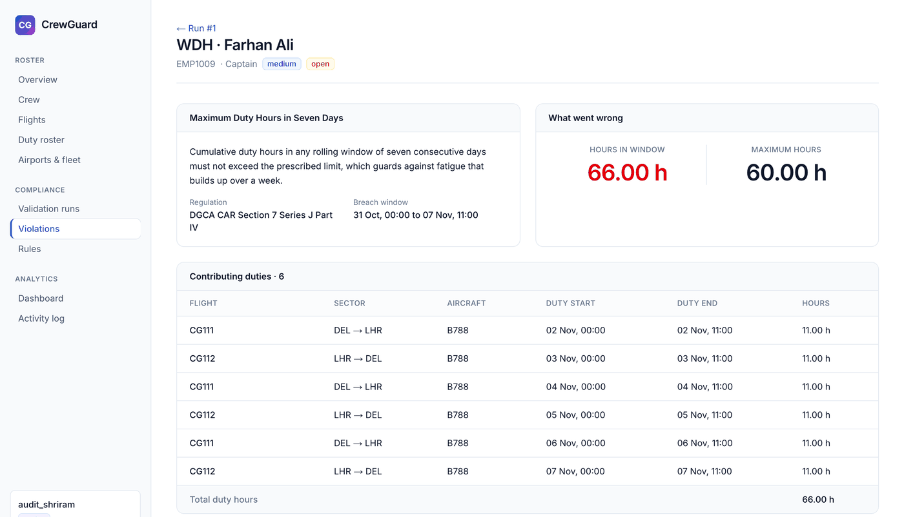

## Contents

[The problem](#the-problem) · [How it works](#how-it-works) · [The rules](#the-rules) · [Screenshots](#screenshots) · [Architecture](#architecture) · [Database](#database) · [MongoDB](#mongodb) · [Roles and pages](#roles-and-pages) · [Setup](#setup) · [Testing](#testing) · [Project structure](#project-structure) · [Team](#team)

## The problem

An airline roster can be fully staffed and still be illegal. Aviation regulators limit how long crew may work and how much rest they must get, and most of those limits depend on time windows across many duties, not on any single flight.

Take a captain with six 11 h duties in six days. Every one of those duties is a valid row, yet together they make 66 h in a week, over the 60 h limit. No single-row check can see that.

CrewGuard is a detector and an explainer, not a roster generator. It separates two kinds of rule:

| | Prevention | Detection |
|---|---|---|
| **What happens** | The database refuses the row | The row is saved, and a validator reports the breach later |
| **Used for** | What is wrong in one row or one pair of rows | What only shows up across many legal-looking rows |
| **Built with** | Constraints and a trigger | A stored procedure with window functions |
| **Example** | Two overlapping duties for one crew member | 66 duty hours in a rolling 7 days |

## How it works

1. **Schedule.** A scheduler builds the roster: crew, type ratings, flights and duty assignments. The database rejects anything impossible.
2. **Validate.** An auditor picks a date range and runs the validator, a stored procedure that checks every crew member against the rules in one transaction.
3. **Explain.** Each breach is saved as a violation and linked to the exact duties that caused it, through the many-to-many `violation_assignment` table.
4. **Keep the evidence.** After the transaction commits, a snapshot of the rule-specific evidence for each violation goes to MongoDB, linked by `violation.evidence_doc_id`.
5. **Review.** The auditor moves each violation from OPEN to ACKNOWLEDGED to RESOLVED. A violation cannot be resolved without a note.
6. **Analyse.** The dashboard compares a SQL `GROUP BY` with MongoDB aggregation pipelines, and the activity log records who did what.

## The rules

| Code | Rule | Limit | Severity | How it is found |
|---|---|---|---|---|
| RST | Rest between two consecutive duties | at least 10 h | HIGH | `LAG()` over each crew member's duties in time order |
| FDP | Length of a single duty | at most 13 h | CRITICAL | Duty length against the limit |
| WDH | Duty hours in any rolling 7 days | at most 60 h | MEDIUM | `SUM() OVER (... RANGE ... PRECEDING)`, keeping each crew member's worst window with `DISTINCT ON` |
| CER | Valid type rating for the aircraft flown (cabin crew exempt) | none | CRITICAL | Anti-join with `NOT EXISTS` on the duty date |
| none | No overlapping duties | none | none | Prevented by an `EXCLUDE USING GIST` constraint |

Limits and severities live in the `rule_definition` table, so a limit can change without touching the code.

The sample data is a two-week roster (2 to 15 Nov 2026, 13 crew, 24 flights, 62 duties) with breaches planted on purpose. The validator should find:

| Period | RST | FDP | WDH | CER | Total |
|---|---|---|---|---|---|
| 2 to 15 Nov | 7 | 2 | 3 | 4 | **16** |
| 2 to 8 Nov | 7 | 0 | 3 | 2 | **12** |
| 9 to 15 Nov | 0 | 2 | 0 | 2 | **4** |

## Screenshots

| Sign in | Overview |
|---|---|
| 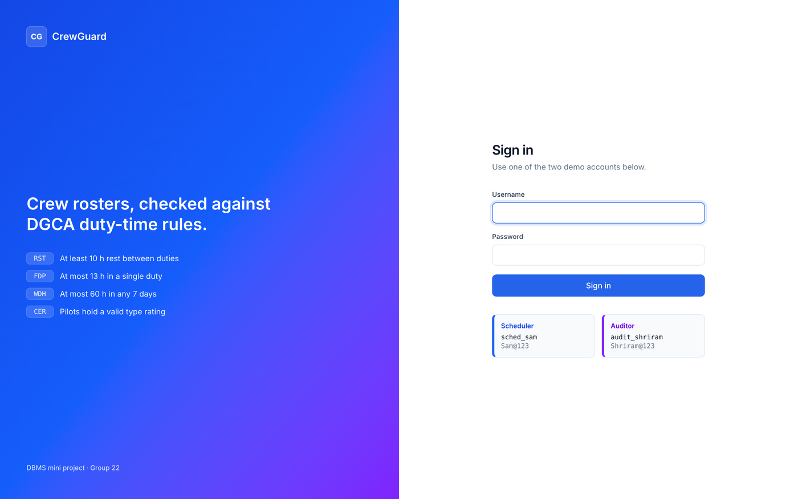 | 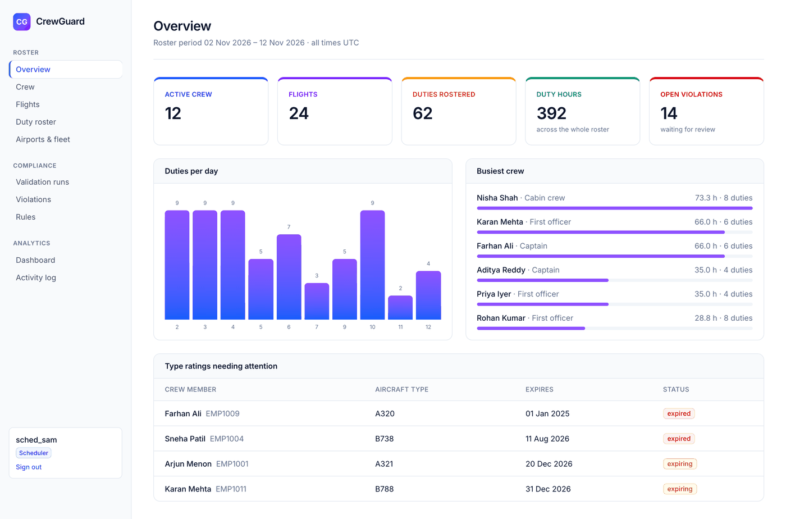 |

| A validation run | Violations |
|---|---|
| 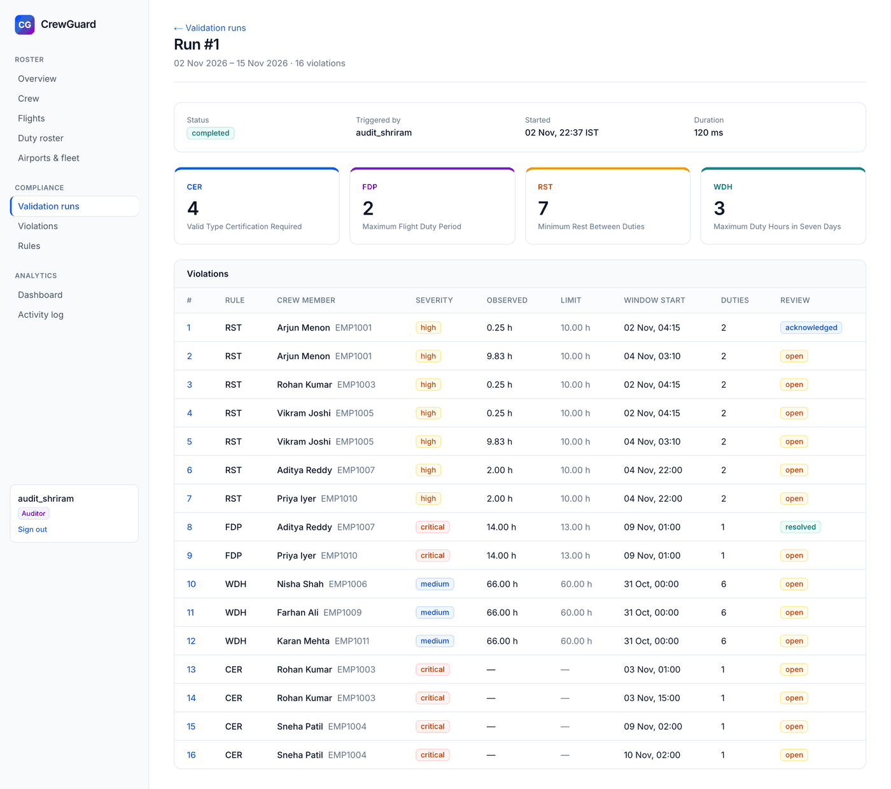 | 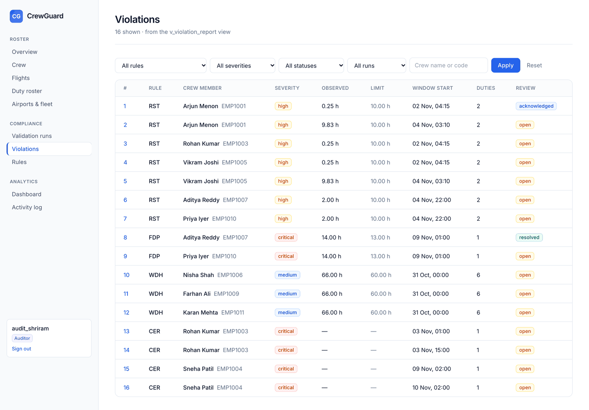 |

| Explanation, evidence and review | Dashboard |
|---|---|
| 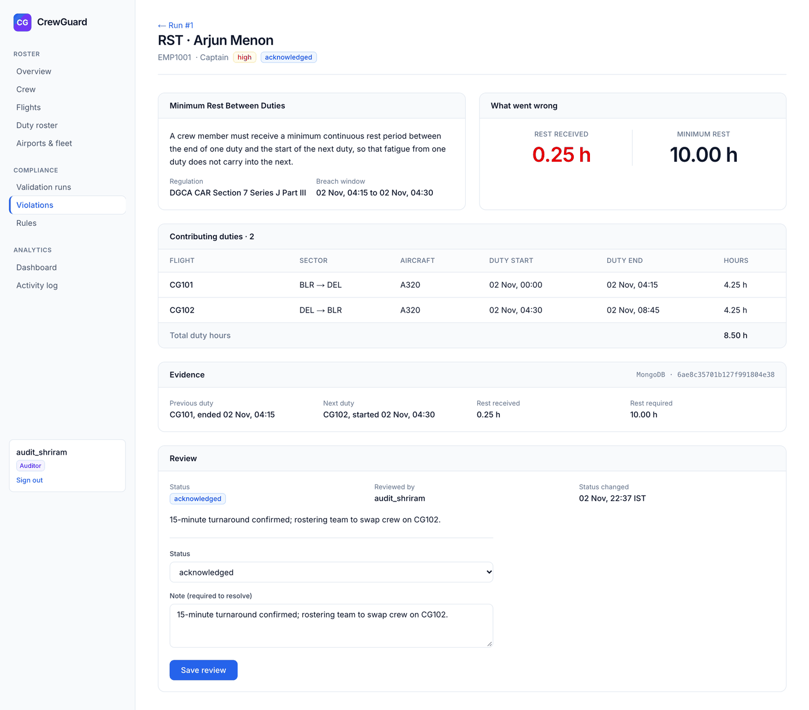 | 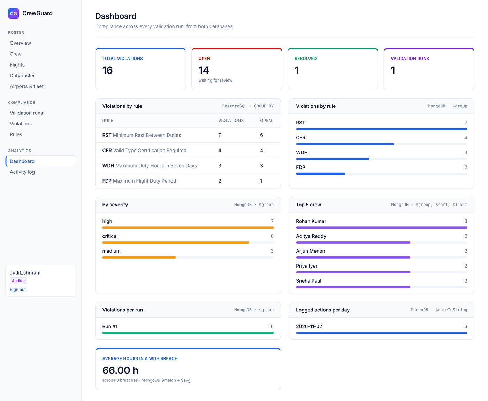 |

| Assigning crew, with rating and overlap hints | The database rejecting a write |
|---|---|
| 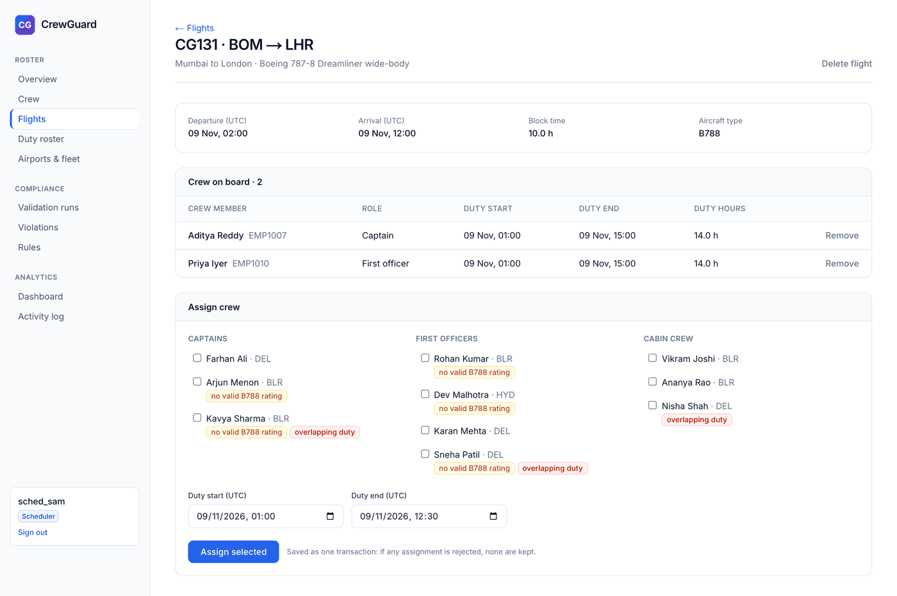 | 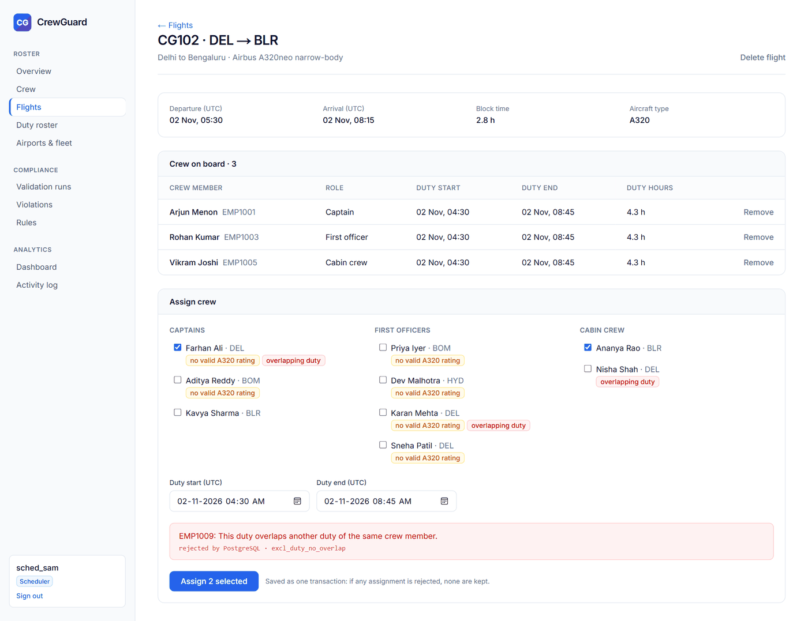 |

| Full-text search on the rules | Activity log |
|---|---|
| 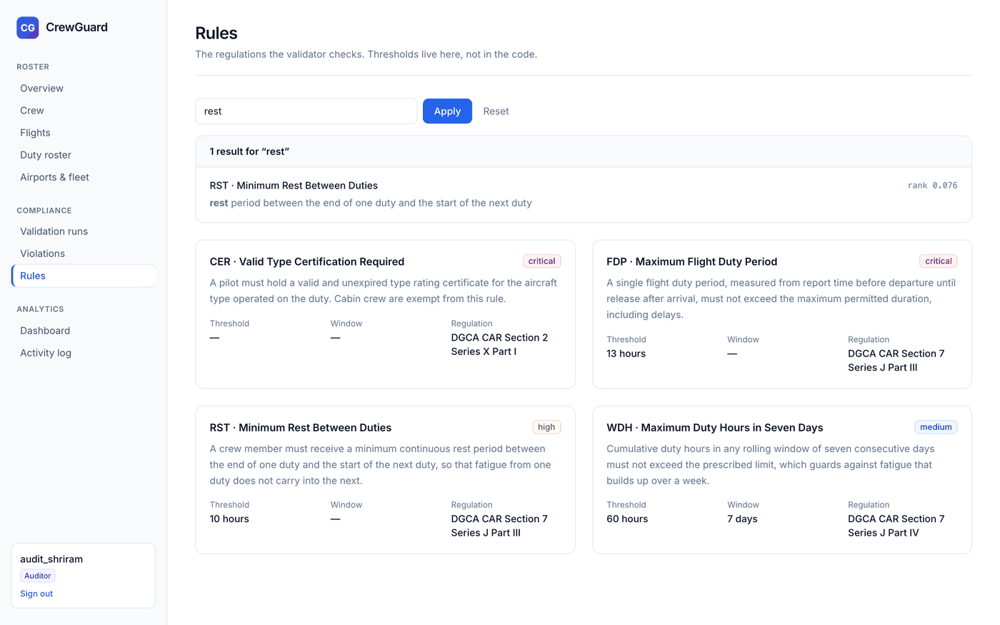 | 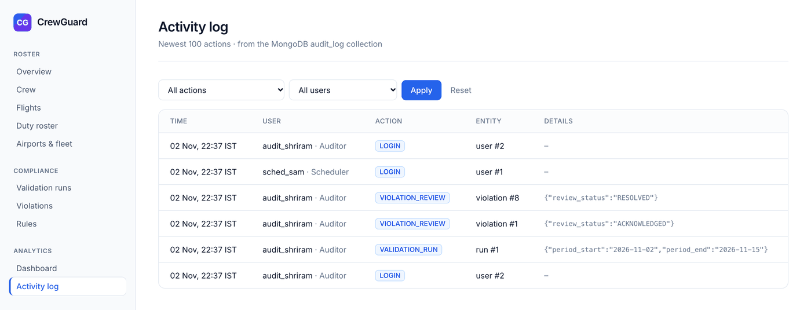 |

Flight and duty times are shown in UTC, as airlines do. Logins, validation runs and reviews happen on the users' clock, so they are shown in IST and labelled.

## Architecture

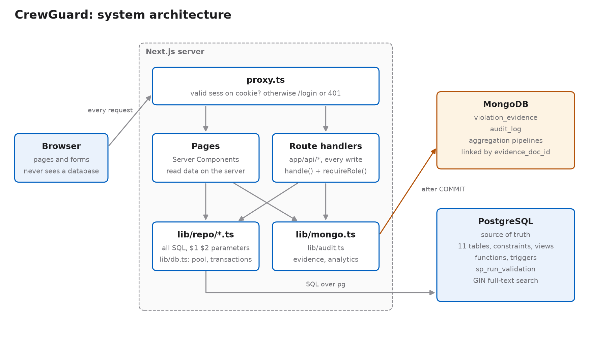

The browser never connects to a database. `proxy.ts` runs first on every request and sends anyone without a valid session to the login page, or returns 401 for the API. Pages are Server Components that read data on the server. Every write goes through a route handler in `app/api/*`, which checks the user's role first.

When a validation runs:

1. The form sends `POST /api/runs`, and `requireRole("AUDITOR")` checks the role.
2. `CALL sp_run_validation(...)` runs inside one transaction, so a failure leaves no half-finished run.
3. After the commit, the evidence documents are written to MongoDB and each `_id` is stored on its violation.
4. The action is logged to `audit_log`, and the browser goes to the new run.

| Concern | How it is handled |
|---|---|
| SQL injection | All SQL is parameterised with `$1, $2`. There is no ORM, so every query is visible in `lib/repo/*` |
| Passwords | Only bcrypt hashes are stored |
| Sessions | A signed JWT in an httpOnly cookie, valid for 8 hours |
| Authorisation | Role checks in every write route: 401 if not signed in, 403 for the wrong role |
| Credentials | In `.env.local`, which is git-ignored |
| Validation errors | When PostgreSQL rejects a row, the page shows a readable message and the name of the constraint |

| Layer | Technology |
|---|---|
| Frontend and API | Next.js 16 (App Router, Route Handlers), React 19, TypeScript, Tailwind CSS 4 |
| Relational database | PostgreSQL 16 or 17 through `pg`, with raw parameterised SQL |
| Document database | MongoDB through the official `mongodb` driver |
| Auth | `bcryptjs` for passwords, `jose` for JWT sessions |
| Tests | Node's built-in test runner |

## Database

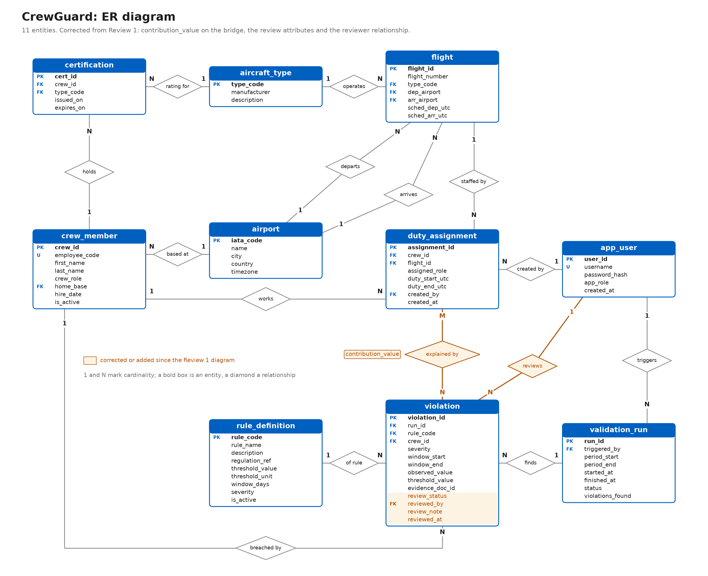

<details>
<summary>Relational schema, with column types and every foreign key</summary>

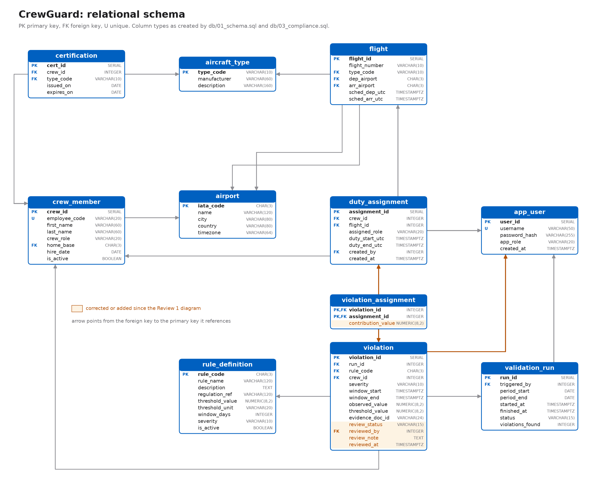

</details>

| Area | Details |
|---|---|
| **11 tables** | `airport`, `aircraft_type`, `app_user`, `crew_member`, `certification`, `flight`, `duty_assignment`, `rule_definition`, `validation_run`, `violation`, `violation_assignment` |
| **Constraints** | Primary and foreign keys with `ON DELETE CASCADE`, `RESTRICT` and `SET NULL`, plus `CHECK`, `UNIQUE`, `NOT NULL` and the `excl_duty_no_overlap` exclusion constraint |
| **Stored procedure** | `sp_run_validation`, the validator for all four rules |
| **Triggers** | `trg_validate_duty` rejects inactive crew, a wrong role, or a duty not covering its flight. `trg_violation_count` keeps the run's count correct, `trg_run_finish` stamps `finished_at`, and `trg_violation_review` stamps `reviewed_at` |
| **Views** | `v_duty_roster`, `v_crew_summary`, `v_violation_report` |
| **Functions** | `fn_duty_hours`, `fn_crew_duty_hours`, `fn_crew_roster` (table-valued), `fn_cert_status` |
| **Transactions** | Assigning several crew to a flight and running a validation are both all-or-nothing |
| **Indexes** | B-tree on foreign key and lookup columns, a composite `(crew_id, duty_start_utc)`, GiST for the exclusion constraint, GIN for full-text search on the rules |
| **Review workflow** | `ALTER TABLE violation` adds `review_status`, `reviewed_by`, `review_note` and `reviewed_at`, with a `CHECK` requiring a note to resolve |

| File | Contents |
|---|---|
| `db/01_schema.sql` | Tables, keys, constraints, indexes, table comments |
| `db/02_roster.sql` | Roster views, functions and trigger |
| `db/03_compliance.sql` | Validator procedure, compliance view and triggers, full-text search |
| `db/04_seed.sql` | The two-week sample roster with planted breaches |
| `db/queries.sql` | The 19 important queries, runnable in psql. Writes run inside `BEGIN ... ROLLBACK` |
| `db/reset.mjs` | Rebuilds the database from the numbered files and empties the MongoDB collections |

## MongoDB

| Collection | Holds | Why a document store |
|---|---|---|
| `violation_evidence` | One document per violation, with rule-specific evidence | The shape differs per rule: a rest gap, a 7-day breakdown, certificate details |
| `audit_log` | One document per user action | Append-only, write-heavy, a different payload per action, never joined |

An evidence document for a rest violation, slightly shortened:

```json
{
  "violation_id": 1, "run_id": 1, "rule_code": "RST", "severity": "HIGH",
  "crew": { "crew_id": 1, "employee_code": "EMP1001", "name": "Arjun Menon", "role": "CAPTAIN" },
  "evidence": {
    "previous_duty": { "flight_number": "CG101", "end": "2026-11-02T04:15:00Z" },
    "next_duty": { "flight_number": "CG102", "start": "2026-11-02T04:30:00Z" },
    "rest_hours": 0.25,
    "required_hours": 10
  }
}
```

The dashboard's aggregation pipelines give violations by rule, by severity and per run, the top 5 crew, the average hours in a WDH breach, and logged actions per day.

PostgreSQL is the source of truth. If MongoDB is down the app keeps working: runs, reviews and roster changes still save, and the pages say where the evidence, charts and activity log would be.

## Roles and pages

| Role | Can |
|---|---|
| `SCHEDULER` | Manage crew, ratings, flights and duty assignments |
| `AUDITOR` | Run validations and review violations |
| Both | Read every page, search and filter |

Demo accounts: `sched_sam` / `Sam@123` (scheduler) and `audit_shriram` / `Shriram@123` (auditor).

| Page | What it shows |
|---|---|
| `/` | Overview: roster totals, open violations, duties per day, busiest crew, ratings needing attention |
| `/crew`, `/crew/[id]` | Crew with search and filters, then weekly hours, ratings and roster for one person |
| `/flights`, `/flights/[id]` | Flights with crew counts, then crew on board and the multi-crew assign form |
| `/roster` | Duty roster with date, role and search filters |
| `/reference` | Airports and fleet, with how much each is used |
| `/runs`, `/runs/[id]` | Validation runs and the form to start one, then counts per rule and the violations found |
| `/violations`, `/violations/[id]` | Violations with filters, then the explanation page with duties, evidence and review |
| `/rules` | The rule catalogue with ranked full-text search |
| `/dashboard` | Stat cards, a SQL panel and the MongoDB charts |
| `/activity` | The newest 100 logged actions, with filters |

## Setup

Prerequisites: **Node.js 20.19+**, **PostgreSQL 16 or 17** and **MongoDB Community 7+**, all installed natively. No Docker.

```bash
git clone https://github.com/samyak-1021/crewguard.git
cd crewguard
npm install
cp .env.example .env.local      # Windows: copy .env.example .env.local
```

Edit `.env.local`:

```
DATABASE_URL=postgres://<user>:<password>@localhost:5432/crewguard
SESSION_SECRET=<any long random string>
MONGODB_URI=mongodb://localhost:27017
MONGODB_DB=crewguard
```

Generate a secret with `node -e "console.log(require('crypto').randomBytes(32).toString('hex'))"`.

```bash
npm run db:reset
npm test
npm run dev        # http://localhost:3000
```

Then sign in as `audit_shriram`, open **Validation runs**, and run 2 to 15 November. You should get 16 violations.

| Command | What it does |
|---|---|
| `npm run db:reset` | Creates the database if needed, then rebuilds the schema and sample data. Safe to re-run at any time |
| `npm test` | Runs all the tests against the database |
| `npm run dev` | Development server |
| `npm run build`, `npm run start` | Production build and server |
| `npm run lint` | ESLint |

<details>
<summary>Troubleshooting</summary>

| Problem | Fix |
|---|---|
| `DATABASE_URL is not set` | `.env.local` is missing or misnamed |
| `password authentication failed` | Wrong password, or special characters are not URL-encoded (`@` becomes `%40`) |
| `permission denied to create extension "btree_gist"` | Connect as a superuser such as `postgres` |
| "Evidence unavailable" or "MongoDB is not reachable" | Start MongoDB and run a new validation. Evidence is written when a run happens, so earlier runs stay without it |
| Times look 5:30 off in psql | Run `SET timezone = 'UTC';`. The app's connection already uses UTC |
| Port 3000 is busy | `npm run dev -- -p 3001` |
| Type errors on `PageProps` or `RouteContext` | Run `npx next typegen` or `npm run dev` once to generate the route types |

</details>

## Testing

`npm test` runs 46 tests against the real database. Every test runs inside `BEGIN ... ROLLBACK`, so the data never changes.

| File | Tests | Covers |
|---|---|---|
| `tests/database.test.mjs` | 22 | Seed data, constraints, the duty trigger, the roster transaction, functions and views |
| `tests/compliance.test.mjs` | 23 | Exact validator results for each period, time zone independence, the duties linked to each violation, renewals and cabin crew, the compliance triggers, review constraints, and full-text search |
| `tests/mongo.test.mjs` | 1 | An aggregation pipeline on a temporary collection. Skips itself if MongoDB is not running |

## Project structure

```
app/          pages (app/(app)/...), login page, API route handlers (app/api/...)
components/   UI components, form helpers, sidebar, evidence panel
lib/          db.ts (pool, transactions), mongo.ts, audit.ts, auth.ts, session.ts, api.ts, format.ts
lib/repo/     all SQL and the MongoDB aggregations
db/           SQL files, sample data, reset script
tests/        database, compliance and MongoDB tests
docs/         report, demo script, diagrams, screenshots, previous review submissions
```

| Document | Contents |
|---|---|
| [`docs/CrewGuard_Report.pdf`](docs/CrewGuard_Report.pdf) | The full project report |
| [`docs/DEMO.md`](docs/DEMO.md) | A 10-minute demo script, with questions to expect |

## Team

| Member | SRN | Part |
|---|---|---|
| Samyak Sanklecha | PES2UG24CS436 | Roster and platform: schema, seed data, roster views, functions and trigger, auth and roles, crew, flights, roster and reference pages, UI theme |
| Shriram Chandrasekar | PES2UG24CS495 | Compliance and analytics: validator procedure, violations and review, rule search, MongoDB evidence, activity log and dashboard, compliance and MongoDB tests, diagrams, demo script, report |
